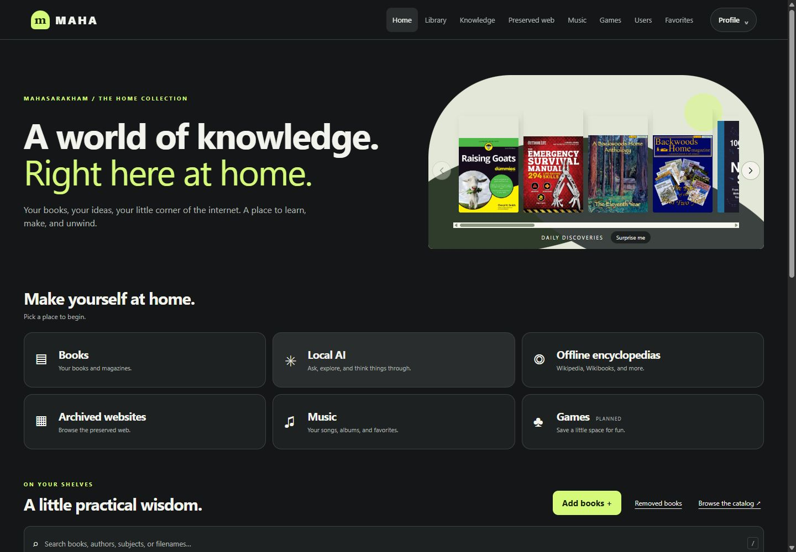
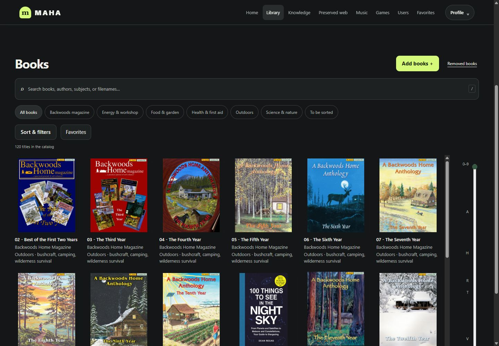
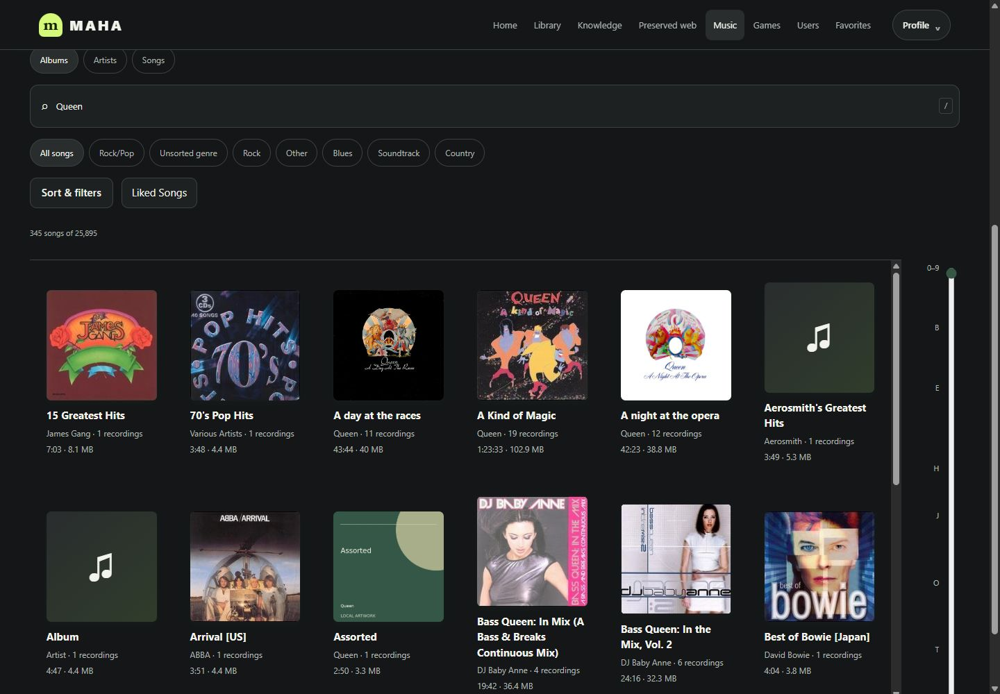
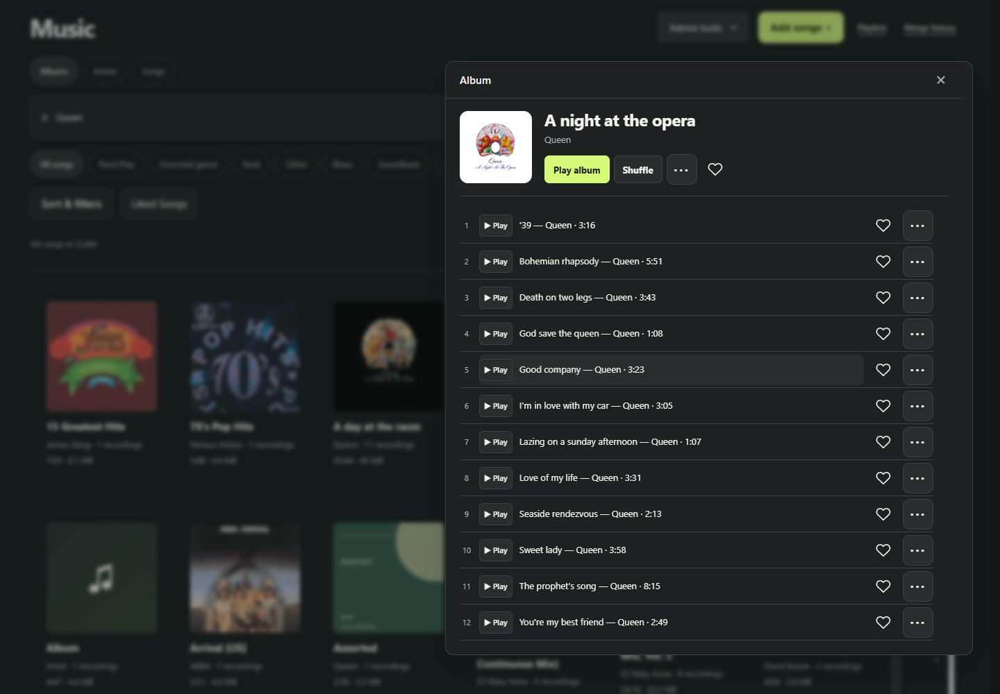
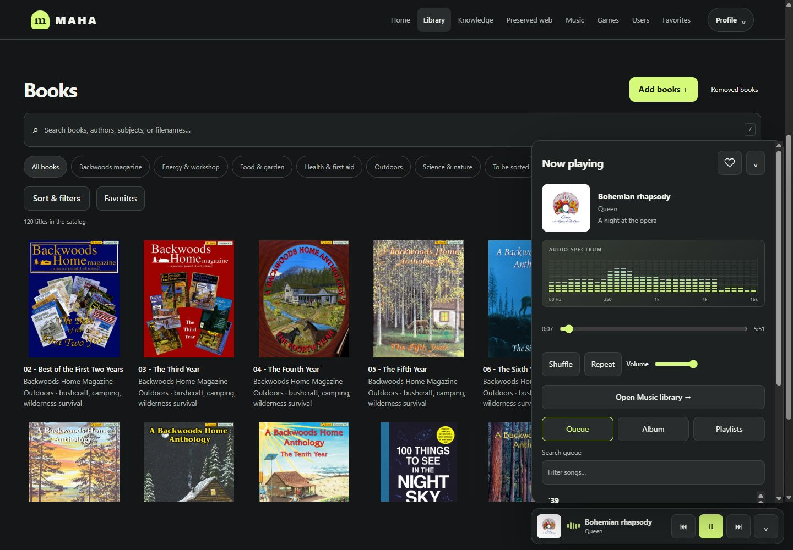
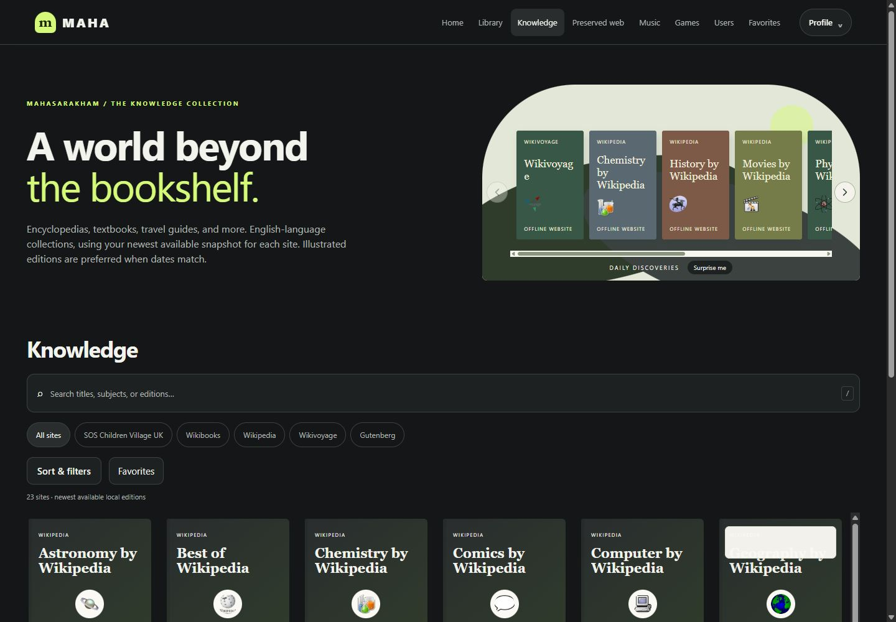
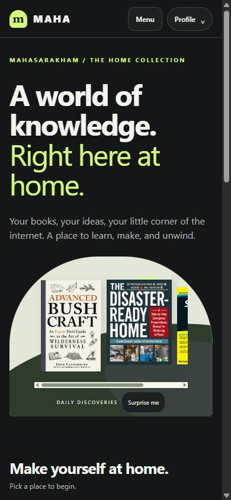

# MAHA screenshots

Captured from the real self-hosted MAHA server on 6 November 2026, in the Midnight theme. Desktop views use a 1440 × 1000 browser viewport; the phone view uses 390 × 844. These are direct browser captures, not mockups. Visible collection titles and covers illustrate the interface; the underlying media and private account data are not included.

## Home and Daily Discoveries

## Book library

Search, category chips, favorites and a responsive cover grid.

## Music search

Album results for a music search, with genre and sorting controls.

## Album details

Artwork, album actions, individual playback and track favorites.

## Listen while browsing

The persistent player stays available over the book library. The spectrum shown here is responding to a real MP3 on the server.

## Offline knowledge

## Phone layout

